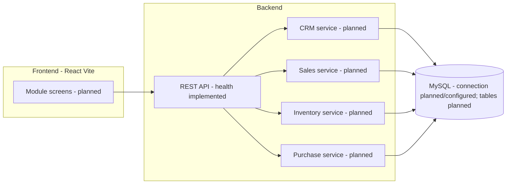
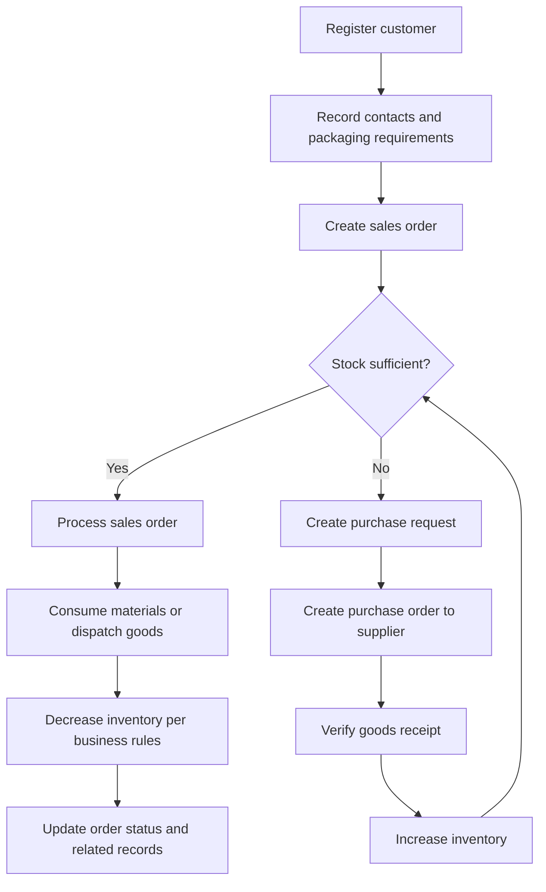
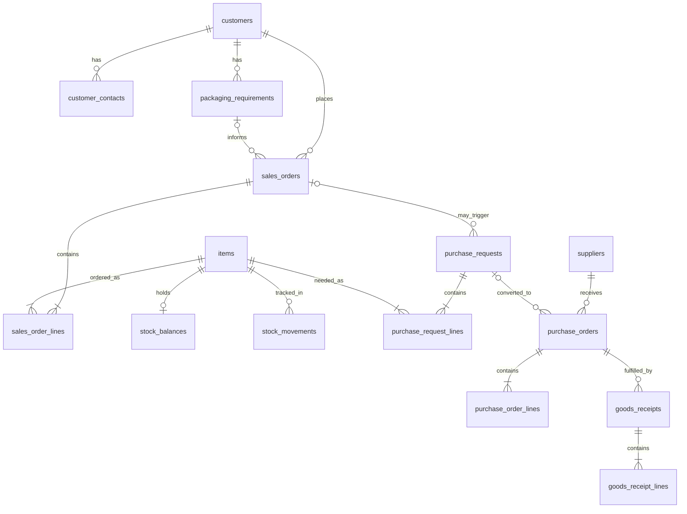

# Packaging Industry ERP Management System

A web-based Enterprise Resource Planning (ERP) prototype for packaging manufacturers. The system is designed to connect customer relationship management, sales orders, inventory, and purchasing so that a customer request can be fulfilled with a clear, auditable path from enquiry to dispatch.

**Current project status:** the React + Vite frontend scaffold and Express backend (including `GET /api/health`) are in place. A MySQL connection pool is configured from environment variables, and `GET /api/health/db` can test it. Business tables, CRM/Sales/Inventory/Purchase APIs, authentication, and module screens are **planned** and are **not implemented**.

---

## Table of contents

1. [Project overview](#1-project-overview)
2. [Problem statement](#2-problem-statement)
3. [Objectives](#3-objectives)
4. [Key features](#4-key-features)
5. [Four application modules](#5-four-application-modules)
6. [Technology stack](#6-technology-stack)
7. [System architecture](#7-system-architecture)
8. [Folder structure](#8-folder-structure)
9. [Complete business workflow](#9-complete-business-workflow)
10. [Individual module workflows](#10-individual-module-workflows)
11. [Planned database tables and relationships](#11-planned-database-tables-and-relationships)
12. [Planned REST API endpoints](#12-planned-rest-api-endpoints)
13. [How the four modules share data](#13-how-the-four-modules-share-data)
14. [Installation instructions](#14-installation-instructions)
15. [Run instructions](#15-run-instructions)
16. [Testing instructions](#16-testing-instructions)
17. [Future enhancements](#17-future-enhancements)
18. [Internship project information](#18-internship-project-information)

---

## 1. Project overview

Packaging companies typically handle many small and large orders at once: cartons, corrugated boxes, labels, films, and related materials. Staff must know who the customer is, what packaging specification they need, whether raw materials or finished goods are in stock, and whether a purchase must be raised before production or dispatch can proceed.

This internship project proposes a focused ERP for that domain. It will (when implemented) keep a single source of truth for:

- customers and their packaging requirements
- sales orders and order status
- stock of raw materials and finished goods
- suppliers, purchase requests, and goods receipts

The intended architecture is a React single-page application that talks to a Node.js REST API, with MySQL as the relational store. **The frontend scaffold, Express server, and MySQL connection code are in place.** Business APIs, database tables, and module screens have not been built.

---

## 2. Problem statement

Many small and mid-size packaging units still coordinate customers, orders, store rooms, and purchases through spreadsheets, phone calls, and paper job cards. That approach creates several operational problems:

- Customer contact details and packaging specifications (size, ply, material, print, quantity) are scattered, so sales staff repeat data entry and make specification errors.
- A sales order may be accepted without a reliable stock check, leading to delayed dispatch or emergency buying.
- Purchase activity is not clearly linked to the sales order that caused the shortage, so follow-up is informal.
- Goods received from suppliers may not be verified against the purchase order, so inventory quantities drift from reality.
- When materials are consumed or goods are dispatched, stock and order status are not updated together, which hides shortages and overselling.

The problem this project addresses is the lack of an integrated, module-based workflow that ties CRM, sales, inventory, and purchasing together through shared records and (planned) REST APIs.

---

## 3. Objectives

| ID | Objective | Status |
| --- | --- | --- |
| O1 | Scaffold a maintainable frontend using React and Vite (JavaScript). | **Completed** in this step |
| O2 | Document the four-module design, workflows, planned schema, and planned APIs. | **Completed** in this README |
| O3 | Implement CRM so customers, contacts, and packaging requirements can be registered. | Planned |
| O4 | Implement sales orders with status tracking linked to a customer. | Planned |
| O5 | Implement inventory with stock checks, receipts, and consumption/dispatch updates. | Planned |
| O6 | Implement purchase requests, suppliers, purchase orders, and goods receipt verification. | Planned |
| O7 | Expose REST APIs so all four modules share the same data store. | Planned |
| O8 | Persist data in MySQL with defined table relationships. | Planned |

---

## 4. Key features

Features below are grouped by delivery status so that this README does not claim unimplemented work.

### Implemented in this step

- React 19 application created with Vite (JavaScript, not TypeScript)
- Frontend development, production build, and lint scripts
- Project documentation for academic review

### Planned product features (not implemented)

- Customer registration and customer master
- Contact persons and communication details
- Packaging requirement / specification records
- Sales order creation, line items, and status updates
- On-hand stock enquiry before order processing
- Automatic or operator-initiated purchase request when stock is insufficient
- Supplier master and purchase orders
- Goods receipt verification and inventory increase
- Recheck of stock after receipts
- Sales order processing and dispatch / material consumption
- Inventory decrease according to documented business rules
- Cross-module updates through REST APIs (single backend, shared database)

---

## 5. Four application modules

### 5.1 CRM / Customer Management (planned)

Maintains the customer master: company name, billing and shipping addresses, GST or tax identifiers (as required by the business), contact persons, phone and email, and packaging requirements (product type, dimensions, material, print, quantity bands, special instructions). Sales orders will reference a customer created in this module.

### 5.2 Sales and Order Management (planned)

Converts a customer requirement into a sales order with line items, requested quantity, promised date, and status (for example Draft, Confirmed, Awaiting Material, Ready, Dispatched, Closed). Before processing, the module will request a stock check from Inventory. If stock is insufficient, it will request a purchase action rather than silently overselling.

### 5.3 Inventory Management (planned)

Tracks items (raw materials and/or finished packaging goods, as defined during implementation), on-hand quantity, reorder levels, receipts, and issues. Inventory is the module that answers “is stock sufficient?” and that applies quantity changes when goods are received, consumed, or dispatched.

### 5.4 Purchase Management (planned)

Maintains suppliers, purchase requests raised from stock shortages, purchase orders, and receipt verification. After verified receipt, Inventory is updated so Sales can recheck stock and continue the order.

---

## 6. Technology stack

| Layer | Technology | Role in this project | Status |
| --- | --- | --- | --- |
| Frontend | React 19, JavaScript | User interface | Scaffold **implemented** |
| Bundler / dev server | Vite 8 | Local development and production build | **Implemented** |
| Frontend lint | Oxlint (Vite template) | Static checks | **Implemented** |
| Backend | Node.js with Express | REST API server | Health routes **implemented** |
| Database | MySQL with `mysql2` connection pool | Persistent relational data | Connection **configured** (tables **not created**) |
| HTTP client | To be selected (for example `fetch` or Axios) | Frontend to API calls | **Not implemented** |
| Version control | Git | Source history | Repository present |

Copy `backend/.env.example` to `backend/.env` and set your own MySQL values. Do not commit `.env`. Business REST APIs are still planned.

---

## 7. System architecture

**Planned** target architecture (logical):

```text
  Browser (React + Vite SPA)
           |
           |  HTTPS / HTTP JSON
           v
  REST API (Node.js / Express)     <-- health endpoints implemented
           |
           |  SQL (mysql2 pool)
           v
  MySQL database                   <-- connection configured; tables not created
```

All four modules will live in one frontend application and one backend service. They will not keep separate databases. Shared identifiers (customer id, item id, order id, purchase order id) will be the integration points.

**Current architecture:** the React client and Express API exist. The frontend does not call business APIs yet. MySQL can be tested with `GET /api/health/db` after local credentials are set.



---

## 8. Folder structure

```text
packaging-erp/
├── README.md                 # This document
├── .gitignore
├── frontend/                 # React + Vite (JavaScript) — scaffolded
│   ├── public/
│   ├── src/
│   │   ├── App.jsx           # Default Vite starter screen (not ERP UI yet)
│   │   ├── main.jsx
│   │   └── ...
│   ├── index.html
│   ├── package.json
│   └── vite.config.js
└── backend/
    ├── .env.example            # Placeholder env vars (copy to .env locally)
    ├── package.json
    └── src/
        ├── app.js
        ├── server.js
        ├── config/             # includes env.js and db.js (mysql2 pool)
        ├── controllers/
        ├── middleware/
        └── routes/
```

---

## 9. Complete business workflow

The intended end-to-end process for a packaging order is as follows. **This workflow is the design target.** It is not executable in the current codebase.

1. **Register a customer (CRM).** Capture legal/trade name, addresses, and status (active/inactive).
2. **Record contact details and packaging requirements (CRM).** Store one or more contacts and the specification needed (for example 5-ply corrugated box, 400 × 300 × 250 mm, 2-colour print, 5,000 units).
3. **Create a sales order (Sales).** Link the order to the customer and requirement; add line items and requested quantities.
4. **Check stock (Inventory).** For each line, compare requested quantity with on-hand (and optionally reserved) quantity.
5. **If stock is insufficient, initiate a purchase request (Purchase + Inventory).** Record the shortage, required item, quantity, and the originating sales order.
6. **Record suppliers and raise purchase orders (Purchase).** Select a supplier, convert the request to a PO, and track PO status.
7. **Verify received materials and update inventory (Purchase + Inventory).** On arrival, check quantity and quality against the PO; post a goods receipt that **increases** on-hand stock only after verification.
8. **Recheck stock (Inventory / Sales).** Confirm that the original sales order can now be fulfilled.
9. **Process the sales order (Sales).** Move the order into processing / ready / dispatch according to rules defined at implementation time.
10. **Update inventory when materials are consumed or goods are dispatched (Inventory).** Decrease stock according to the business rules below.
11. **Update order status and related records (Sales, and linked Purchase/Inventory documents).** Close or partially close the sales order; keep a trail of related purchase and stock movements.

### Planned inventory business rules (design, not coded)

- Stock is never assumed; Sales must obtain a stock check result from Inventory.
- A shortage creates (or is linked to) a purchase request; the sales order should move to a waiting-for-material status rather than being marked dispatched.
- Goods receipt increases on-hand quantity only after verification against the purchase order.
- Dispatch of finished goods, or consumption of raw materials used to fulfil the order, decreases inventory in the same transaction family as the order status change (exact posting model to be implemented later).
- Related records (sales order, purchase request, PO, receipt, stock ledger) keep foreign keys so the full chain can be audited.



---

## 10. Individual module workflows

### CRM / Customer Management (planned)

1. Create or update customer master.
2. Add contact persons (name, role, phone, email).
3. Capture packaging requirements / specifications.
4. Expose the customer and requirement ids for Sales to use.

### Sales and Order Management (planned)

1. Select customer and optional requirement.
2. Enter order header and line items.
3. Request stock availability for each item.
4. If short, attach or trigger a purchase request; set status to awaiting material.
5. After stock is available, process the order.
6. On dispatch or completion, request inventory issue and set final status.

### Inventory Management (planned)

1. Maintain item master and opening / on-hand quantities.
2. Answer availability queries from Sales.
3. Post increases from verified purchase receipts.
4. Post decreases from consumption or dispatch.
5. Optionally flag reorder level so Purchase can act even without a specific sales order (enhancement).

### Purchase Management (planned)

1. Maintain supplier master.
2. Create purchase request from a shortage (linked to sales order and item).
3. Convert request to purchase order.
4. Record delivery and verification.
5. Notify Inventory to post the receipt.

---

## 11. Planned database tables and relationships

The following schema is **planned**. No tables have been created in MySQL in this step.

### Planned tables

| Table | Purpose |
| --- | --- |
| `customers` | Customer master |
| `customer_contacts` | Contact persons for a customer |
| `packaging_requirements` | Specification / requirement against a customer |
| `items` | Raw materials and/or finished goods |
| `stock_balances` | Current on-hand (and later reserved) quantity per item |
| `stock_movements` | Ledger of receipts, issues, and adjustments |
| `sales_orders` | Sales order header |
| `sales_order_lines` | Ordered items and quantities |
| `suppliers` | Supplier master |
| `purchase_requests` | Shortage-driven purchase requests |
| `purchase_request_lines` | Items and quantities to buy |
| `purchase_orders` | PO header to a supplier |
| `purchase_order_lines` | PO items |
| `goods_receipts` | Verified receipts against a PO |
| `goods_receipt_lines` | Received quantities |

### Planned relationships

- `customer_contacts.customer_id` → `customers.id`
- `packaging_requirements.customer_id` → `customers.id`
- `sales_orders.customer_id` → `customers.id`
- `sales_orders.requirement_id` → `packaging_requirements.id` (optional)
- `sales_order_lines.sales_order_id` → `sales_orders.id`
- `sales_order_lines.item_id` → `items.id`
- `stock_balances.item_id` → `items.id`
- `stock_movements.item_id` → `items.id`
- `purchase_requests.sales_order_id` → `sales_orders.id` (when raised from an order)
- `purchase_request_lines.purchase_request_id` → `purchase_requests.id`
- `purchase_request_lines.item_id` → `items.id`
- `purchase_orders.supplier_id` → `suppliers.id`
- `purchase_orders.purchase_request_id` → `purchase_requests.id` (optional)
- `purchase_order_lines.purchase_order_id` → `purchase_orders.id`
- `goods_receipts.purchase_order_id` → `purchase_orders.id`
- `goods_receipt_lines.goods_receipt_id` → `goods_receipts.id`
- `stock_movements` may reference `sales_order_id`, `purchase_order_id`, or `goods_receipt_id` depending on movement type



---

## 12. Planned REST API endpoints

These endpoints are **planned**. They are not implemented and must not be called yet.

Base URL (planned): `http://localhost:<api-port>/api`

### CRM

| Method | Path | Purpose |
| --- | --- | --- |
| GET | `/customers` | List customers |
| POST | `/customers` | Register a customer |
| GET | `/customers/:id` | Get customer |
| PUT | `/customers/:id` | Update customer |
| GET | `/customers/:id/contacts` | List contacts |
| POST | `/customers/:id/contacts` | Add contact |
| GET | `/customers/:id/requirements` | List packaging requirements |
| POST | `/customers/:id/requirements` | Add packaging requirement |

### Sales

| Method | Path | Purpose |
| --- | --- | --- |
| GET | `/sales-orders` | List sales orders |
| POST | `/sales-orders` | Create sales order |
| GET | `/sales-orders/:id` | Get order with lines |
| PUT | `/sales-orders/:id` | Update draft order |
| POST | `/sales-orders/:id/stock-check` | Request stock check for all lines |
| PATCH | `/sales-orders/:id/status` | Update order status |
| POST | `/sales-orders/:id/process` | Process order when stock is available |
| POST | `/sales-orders/:id/dispatch` | Record dispatch and request inventory issue |

### Inventory

| Method | Path | Purpose |
| --- | --- | --- |
| GET | `/items` | List items |
| POST | `/items` | Create item |
| GET | `/items/:id` | Get item |
| GET | `/inventory/stock?itemId=` | On-hand quantity |
| POST | `/inventory/availability` | Check quantities for a list of items |
| GET | `/inventory/movements` | Stock ledger (filtered) |
| POST | `/inventory/receipts` | Post verified receipt (increase stock) |
| POST | `/inventory/issues` | Post consumption or dispatch (decrease stock) |

### Purchase

| Method | Path | Purpose |
| --- | --- | --- |
| GET | `/suppliers` | List suppliers |
| POST | `/suppliers` | Register supplier |
| GET | `/suppliers/:id` | Get supplier |
| GET | `/purchase-requests` | List purchase requests |
| POST | `/purchase-requests` | Create request from shortage |
| GET | `/purchase-orders` | List purchase orders |
| POST | `/purchase-orders` | Create PO |
| GET | `/purchase-orders/:id` | Get PO with lines |
| PATCH | `/purchase-orders/:id/status` | Update PO status |
| POST | `/purchase-orders/:id/receipts` | Verify receipt and trigger inventory update |

Exact status codes, validation rules, and authentication will be defined when the backend is implemented.

---

## 13. How the four modules share data

**Planned integration model:** one REST API and one MySQL database. The React frontend will not copy master data between screens. Each screen will read and write through HTTP.

Typical sharing path for one order:

1. CRM writes `customers` and `packaging_requirements`.
2. Sales reads those records (`GET /customers`, `GET /customers/:id/requirements`) and writes `sales_orders`.
3. Sales calls Inventory (`POST /inventory/availability` or `POST /sales-orders/:id/stock-check`, which internally uses inventory data).
4. If short, Sales or Inventory creates a Purchase document (`POST /purchase-requests`) with `sales_order_id` and `item_id`.
5. Purchase writes `suppliers`, `purchase_orders`, and receipts; receipt posting calls Inventory (`POST /inventory/receipts`) so `stock_balances` increase.
6. Sales rechecks stock, processes the order, then calls Inventory (`POST /inventory/issues`) so stock decreases when materials are consumed or goods are dispatched.
7. Sales updates order status; related purchase and inventory rows remain linked by foreign keys.

Until the API exists, modules cannot share live data. The frontend starter does not include these calls.

---

## 14. Installation instructions

### Prerequisites

- Node.js 20 or later (includes npm)
- Git
- A modern browser (Chrome, Edge, or Firefox)
- MySQL Server (required only to verify `GET /api/health/db`)

### Clone or open the project

```powershell
cd C:\Users\dhava\packaging-erp
```

### Install frontend dependencies

```powershell
cd frontend
npm install
```

### Install backend dependencies

```powershell
cd C:\Users\dhava\packaging-erp\backend
npm install
```

### Configure MySQL (local only)

1. Install and start MySQL Server if it is not already running (default port is usually `3306`).
2. Create an empty database using your own MySQL client, for example:

```sql
CREATE DATABASE packaging_erp;
```

3. Copy the example environment file and **replace the placeholders with your own MySQL username and password**. Never commit `.env`.

```powershell
cd C:\Users\dhava\packaging-erp\backend
copy .env.example .env
```

4. Edit `backend/.env`. Keep `DB_HOST`, `DB_PORT`, `DB_USER`, `DB_PASSWORD`, and `DB_NAME`. Use the username and password you already use to log in to MySQL. This project does not ship real credentials.

This step does **not** create CRM, sales, inventory, or purchase tables.

---

## 15. Run instructions

### Start the frontend development server

From the `frontend` folder:

```powershell
cd C:\Users\dhava\packaging-erp\frontend
npm install
npm run dev
```

Vite will print a local URL (typically `http://localhost:5173`). Open that URL in a browser. You should see the default Vite + React starter page, not an ERP dashboard.

### Production build (optional)

```powershell
cd C:\Users\dhava\packaging-erp\frontend
npm run build
npm run preview
```

### Backend

```powershell
cd C:\Users\dhava\packaging-erp\backend
npm run dev
```

- App health: `http://localhost:5000/api/health`
- MySQL health: `http://localhost:5000/api/health/db` (needs a running MySQL server and a correctly filled `.env`)

---

## 16. Testing instructions

Automated unit or API tests are **not part of this step**.

### Verify the frontend scaffold

1. Install dependencies (`npm install` in `frontend`).
2. Run `npm run build` and confirm the build completes without errors.
3. Run `npm run lint` (Oxlint) and confirm it exits successfully.
4. Run `npm run dev` and confirm the starter page loads.

### Verify the backend and MySQL connection

1. Install dependencies (`npm install` in `backend`).
2. Copy `.env.example` to `.env` and set your MySQL values.
3. Run `npm run dev` in `backend`.
4. Open `http://localhost:5000/api/health` and confirm JSON `success: true`.
5. Open `http://localhost:5000/api/health/db`. Success means MySQL accepted the connection. An error JSON means the server, database name, or credentials need to be fixed.

### Planned later testing (not available yet)

- Module UI tests for CRM, Sales, Inventory, and Purchase
- API tests for the endpoints listed above
- Workflow tests: shortage → purchase → receipt → recheck → dispatch
- Database constraint tests for the planned foreign keys

---

## 17. Future enhancements

These items are out of scope until the four core modules exist:

- User login, roles (sales, store, purchase, admin), and audit logs
- Quotations and pricing / rate cards
- Production or job-card module for converting raw materials to finished boxes
- Barcode or batch/lot tracking
- GST invoices and payment collection
- Dashboards and low-stock alerts
- Document upload (artwork, purchase invoices)
- Deployment to a hosted environment

---

## 18. Internship project information

| Field | Detail |
| --- | --- |
| Project title | Packaging Industry ERP Management System |
| Project type | College internship / academic software project |
| Domain | Packaging manufacturing operations |
| Nature of work | Full-stack web application (frontend first) |
| Modules in scope | CRM, Sales and Order Management, Inventory, Purchase |
| Current milestone | Frontend scaffold, Express health API, MySQL connection pool |
| Out of scope for this milestone | Business tables, CRM/Sales/Inventory/Purchase APIs, ERP screens, authentication |
| Suggested next milestone (awaiting confirmation) | Backend folder setup **or** first CRM UI mock — to be decided with the intern/guide |

Student name, enrollment number, college, company/guide, and academic year should be filled in by the intern before submission (they are not stored in this repository).

---

## Disclaimer

This README describes **planned** behaviour for learning and evaluation. Features, tables, and APIs marked as planned are design documents only. Claiming they are live would be incorrect until they are implemented and tested.
